# Smart Speech Coach

Smart Speech Coach is an AI-enabled full-stack web application. The React/Vite
frontend sends questions to a Node.js/Express backend using `fetch`. The
backend calls Gemini and returns the answer to the frontend.

## Deployed Application

- Frontend: <https://gen-lang-client-0800605818.web.app>
- Backend: <https://smart-speech-coach-backend-389363739519.us-central1.run.app>
- Health check: <https://smart-speech-coach-backend-389363739519.us-central1.run.app/api/health>
- Google Cloud and Firebase project ID: `gen-lang-client-0800605818`

These URLs were generated at the time of deployment and are included as
deployment evidence. They may no longer be active or reachable. When
reproducing the deployment, use the URLs printed by the current Cloud Run and
Firebase Hosting commands instead.

The frontend is hosted by Firebase Hosting. The backend runs on Cloud Run in
the `us-central1` region.

## Environment Setup

Create these local files from the example files. They are ignored by Git:

```text
frontend/.env
backend/.env
backend/.env.cloudrun
```

The local backend file uses dotenv format:

```env
GEMINI_API_KEY=YOUR_GEMINI_API_KEY
port=3001
allowedOrigins=http://localhost:5173,http://127.0.0.1:5173,https://gen-lang-client-0800605818.web.app
geminiAskAnythingModel=gemini-3.8-flash
askAnythingPrompt="You are going to answer questions about Smart Speech Coach. Keep responses concise."
```

The Cloud Run file uses YAML format and does not define `PORT`, because Cloud
Run provides that variable:

```yaml
GEMINI_API_KEY: "YOUR_GEMINI_API_KEY"
geminiAskAnythingModel: "gemini-3.8-flash"
askAnythingPrompt: "You are going to answer questions about Smart Speech Coach. Keep responses concise."
allowedOrigins: "http://localhost:5173,http://127.0.0.1:5173,https://gen-lang-client-0800605818.web.app"
```

The example file is currently named `backend/.env.coudrun.example` (with a
typo). Copy it to `backend/.env.cloudrun` and use the YAML format above.

Set `frontend/.env` to use the deployed backend:

```env
VITE_SERVER_REMOTE=Y
VITE_SERVER_URL_REMOTE=https://smart-speech-coach-backend-389363739519.us-central1.run.app
VITE_SERVER_URL_LOCAL=http://localhost:3001
```

Never commit environment files because they contain the Gemini API key.

## Local Development

```bash
cd backend && npm install
cd ../frontend && npm install
npm run lint
npm run build
```

Start the backend with `npm run dev` from `backend`, then start the frontend
with `npm run dev` from `frontend`. The local frontend runs at
`http://localhost:5173` and calls `http://localhost:3001` when
`VITE_SERVER_REMOTE=N`.

Test the local backend:

```bash
curl http://localhost:3001/api/health
```

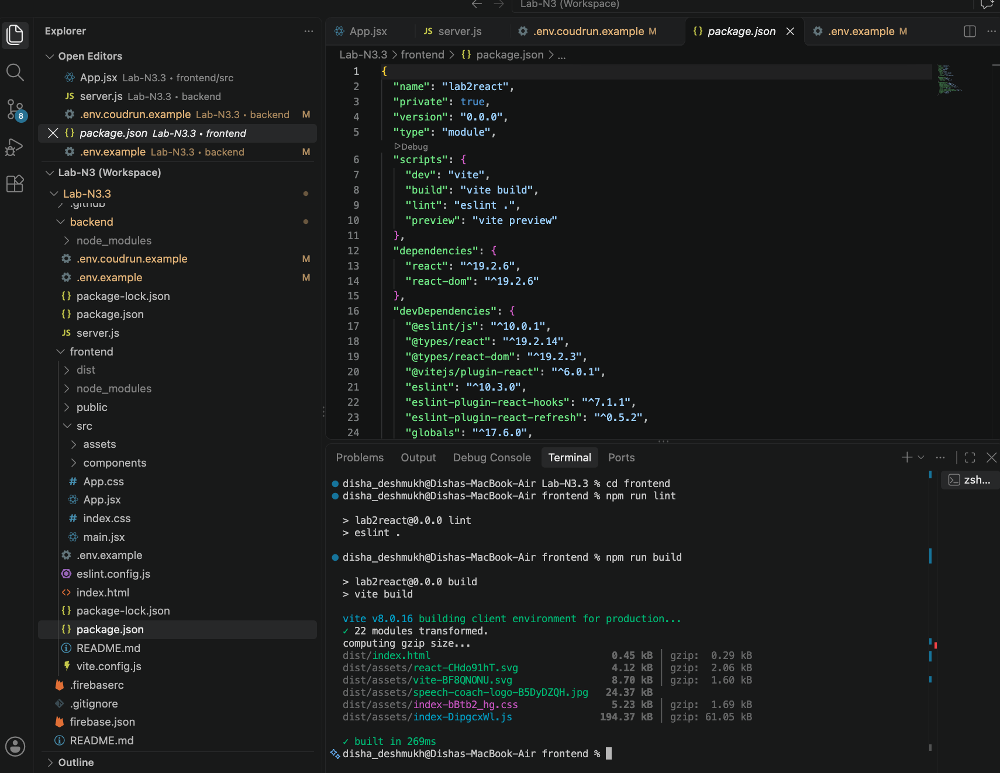

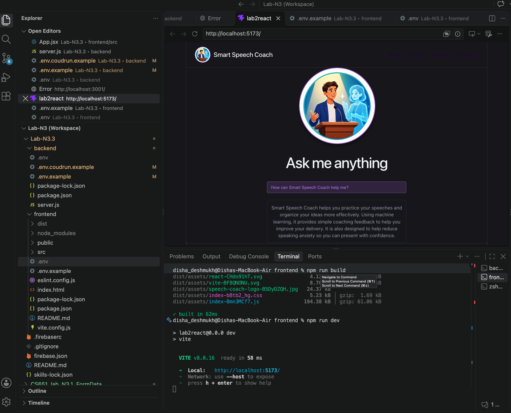

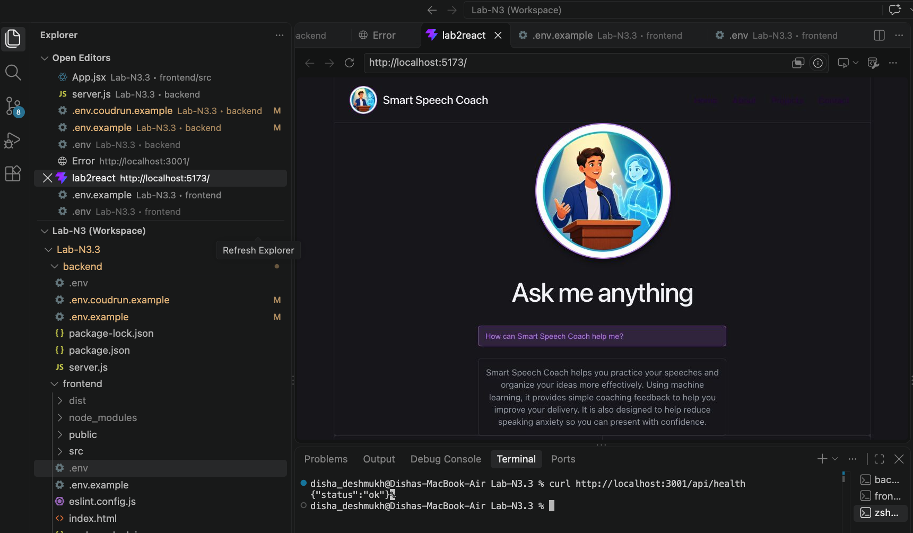

# Lab N3.3 — Google Cloud Run

```bash
gcloud auth login
gcloud auth list
gcloud config set project gen-lang-client-0800605818
```

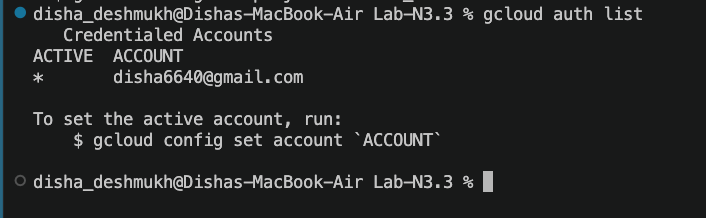

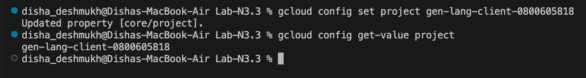

Deploy from `backend`:

```bash
cd backend
gcloud run deploy smart-speech-coach-backend --source . --project gen-lang-client-0800605818 --region us-central1 --allow-unauthenticated --env-vars-file .env.cloudrun
```

`--source .` builds the Node.js service with Google Cloud Buildpacks.
`--allow-unauthenticated` permits the public Firebase frontend to call it.

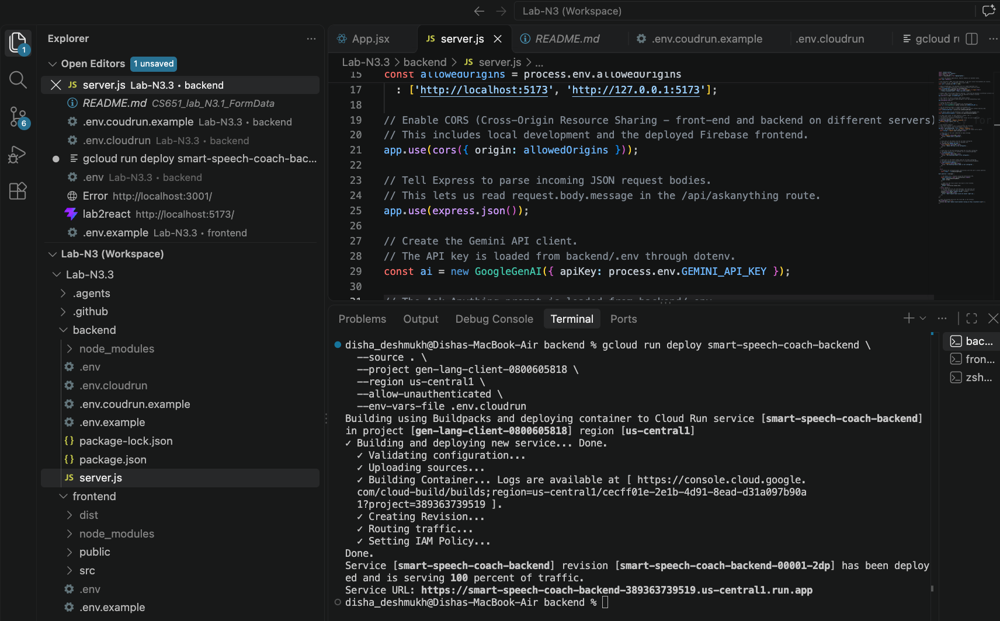

Test the deployed backend:

```bash
export CLOUD_RUN_URL="https://smart-speech-coach-backend-389363739519.us-central1.run.app"
curl "$CLOUD_RUN_URL/api/health"
curl -X POST "$CLOUD_RUN_URL/api/askanything" -H "Content-Type: application/json" -d '{"message":"Give me one public speaking tip."}'
```

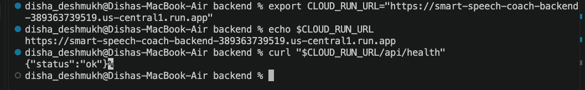

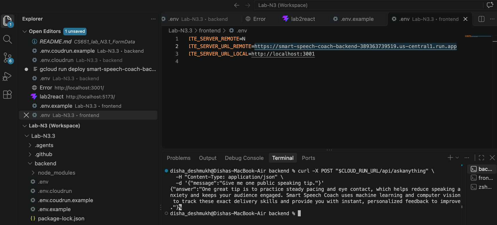

## Firebase Hosting Deployment

Firebase was enabled on the existing Gemini project. The project ID
`gen-lang-client-0800605818` is used by both Google Cloud and Firebase; it is a
project identifier, not a Firebase account.

```bash
npx -y firebase-tools@latest login
npx -y firebase-tools@latest use
npx -y firebase-tools@latest projects:list
```

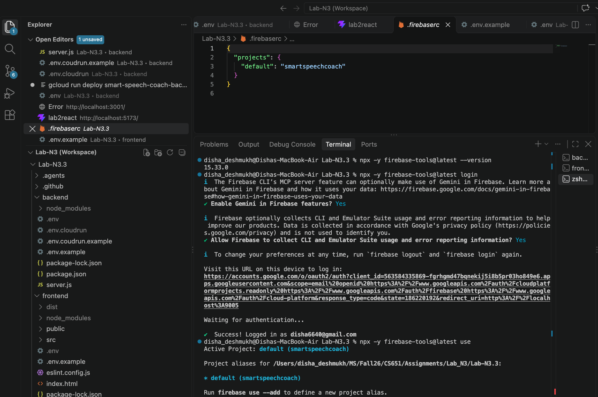

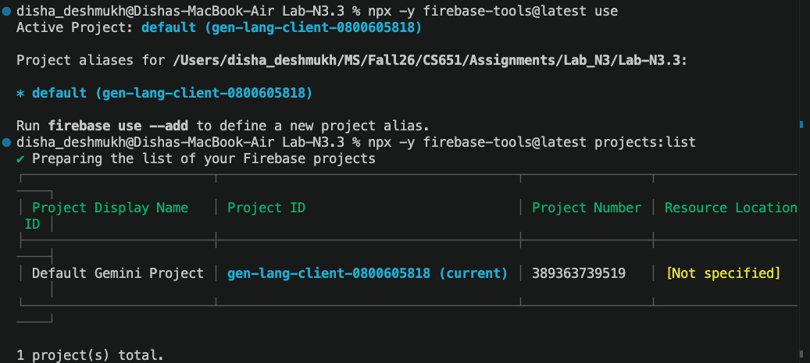

Build the frontend after setting `VITE_SERVER_URL_REMOTE`:

```bash
cd frontend
npm run build
```

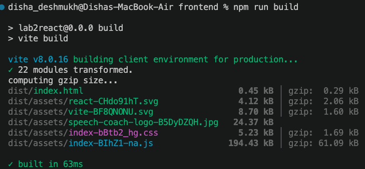

Deploy the `frontend/dist` directory configured in `firebase.json`:

```bash
cd ..
npx -y firebase-tools@latest deploy --only hosting
```

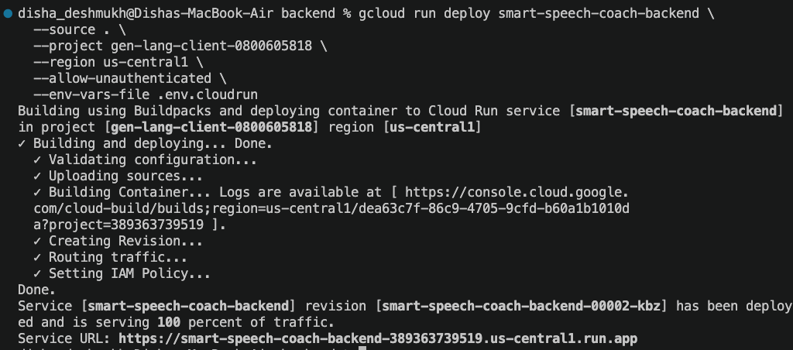

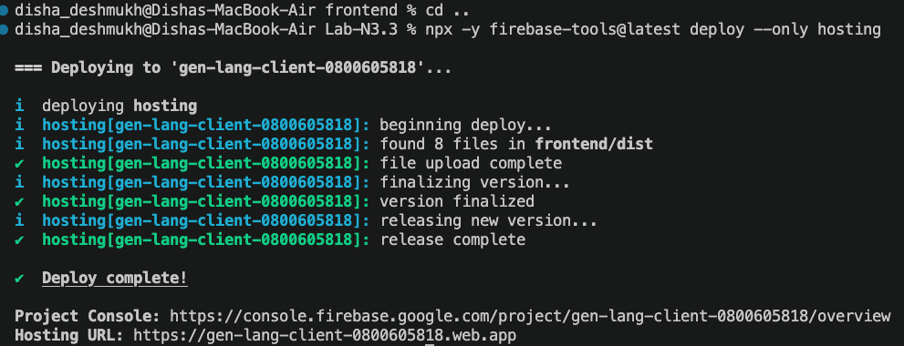

## Production Verification

```bash
curl https://smart-speech-coach-backend-389363739519.us-central1.run.app/api/health
```

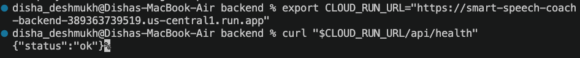

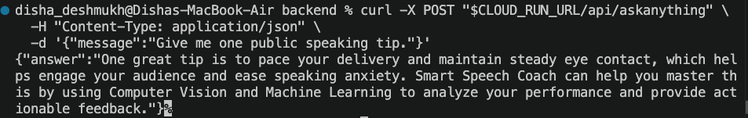

Open <https://gen-lang-client-0800605818.web.app>, submit a question, and
confirm that the answer is displayed. The browser sends `POST /api/askanything`
to Cloud Run and renders the returned `answer`.

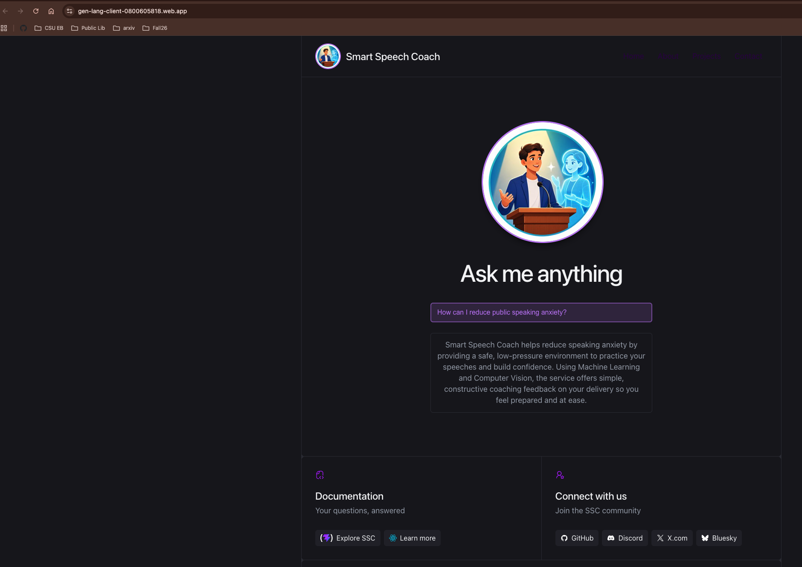

---

# Lab N3.4 — AWS Elastic Beanstalk

For Lab N3.4, the same Smart Speech Coach application from Lab N3.3 was deployed to **AWS Elastic Beanstalk**. In the final deployment, both the React production frontend and the Node.js/Express backend are hosted together in the same Elastic Beanstalk environment.

## N3.4 Architecture

```text
Browser
   |
   v
AWS Elastic Beanstalk
   |
   +--> React Production Frontend
   |
   +--> Node.js / Express Backend
             |
             v
        Google Gemini API
             |
             v
        JSON Response
             |
             v
        React UI
```

The React application is built with Vite and copied into the backend's `public` directory. Express serves the frontend files and also handles the `/api` routes.

## Technologies Used

### Frontend
- React
- Vite
- JavaScript
- HTML
- CSS
- `fetch()` API

### Backend
- Node.js
- Express
- CORS
- dotenv
- Google Gemini API
- `@google/genai`

### Cloud Platform
- AWS Elastic Beanstalk
- Nginx reverse proxy

## How the Application Works

The user opens the Elastic Beanstalk URL and loads the React frontend directly from the AWS-hosted Express application.

When the user submits a question, the frontend sends a POST request to:

```text
/api/askanything
```

The Express backend sends the request to the Gemini API. Gemini generates a response, and the backend returns the answer to the frontend as JSON.

Example response:

```json
{
  "answer": "Generated response from Gemini"
}
```

The answer is displayed in the React interface without reloading the page.

## Frontend Configuration

For the combined Elastic Beanstalk deployment, the frontend was configured to use the same host for API requests:

```env
VITE_SERVER_REMOTE=Y
VITE_SERVER_URL_REMOTE=
VITE_SERVER_URL_LOCAL=http://localhost:3001
```

`VITE_SERVER_URL_REMOTE` is intentionally left blank. This causes the production frontend to use relative API paths such as:

```text
/api/askanything
```

This avoids the need for a separate backend URL because both frontend and backend run in the same Elastic Beanstalk environment.

## Build the React Frontend

From the `frontend` directory:

```bash
npm install
npm run build
```

Vite creates the production build in:

```text
frontend/dist
```

The production files are then copied into:

```text
backend/public
```

On Windows PowerShell, the copy can be performed with:

```powershell
Remove-Item ".\backend\public" -Recurse -Force -ErrorAction SilentlyContinue
Copy-Item ".\frontend\dist" ".\backend\public" -Recurse
```

## Express Frontend Hosting

The Express backend was configured to serve the production React build from `backend/public`.

```javascript
import path from 'path';
import { fileURLToPath } from 'url';

const __filename = fileURLToPath(import.meta.url);
const __dirname = path.dirname(__filename);

app.use(express.static(path.join(__dirname, 'public')));

app.get(/^(?!\/api).*/, (request, response) => {
  response.sendFile(path.join(__dirname, 'public', 'index.html'));
});
```

The API routes remain available at `/api/...`, while all non-API browser routes return the React application.

## Backend Configuration

The backend uses environment variables for the Gemini configuration.

The following values were configured in Elastic Beanstalk environment properties:

```text
GEMINI_API_KEY
geminiAskAnythingModel
askAnythingPrompt
allowedOrigins
```

The Gemini API key is not stored in the repository or included in the deployment ZIP.

The backend uses the cloud-provided port when deployed:

```javascript
const port = process.env.PORT || 3001;
```

Elastic Beanstalk provides the `PORT` value automatically.

## Elastic Beanstalk Deployment Package

The final Elastic Beanstalk deployment package contains:

```text
server.js
package.json
package-lock.json
public/
  index.html
  assets/
.platform/
  nginx/
    conf.d/
      timeout.conf
```

The following files are not included:

```text
node_modules/
.env
frontend source files
```

## Nginx Timeout Configuration

Gemini responses can take longer than the default Elastic Beanstalk Nginx proxy timeout. During testing, requests to `/api/askanything` initially returned a `504 Gateway Time-out`.

The following file was added:

```text
.platform/nginx/conf.d/timeout.conf
```

Contents:

```nginx
proxy_connect_timeout 180s;
proxy_send_timeout 180s;
proxy_read_timeout 180s;
send_timeout 180s;
```

This allows longer Gemini requests to complete successfully.

## Creating the Deployment ZIP on Windows

The deployment archive was created with `tar.exe` rather than PowerShell `Compress-Archive` because the first ZIP used Windows backslashes as path separators and Elastic Beanstalk could not extract it correctly.

From the `backend` directory:

```powershell
tar.exe -a -c -f SmartSpeechCoach-fullstack-v3.zip `
  server.js `
  package.json `
  package-lock.json `
  public `
  .platform
```

Verify the archive with:

```powershell
tar.exe -tf SmartSpeechCoach-fullstack-v3.zip
```

Expected paths include:

```text
server.js
package.json
package-lock.json
public/index.html
public/assets/...
.platform/nginx/conf.d/timeout.conf
```

## AWS Elastic Beanstalk Deployment

The application was deployed as a Node.js Elastic Beanstalk web-server environment.

### Application URL

```text
http://smartspeechcoach-env.eba-gpqzpnwp.us-east-2.elasticbeanstalk.com
```

### Health Check

```text
http://smartspeechcoach-env.eba-gpqzpnwp.us-east-2.elasticbeanstalk.com/api/health
```

Expected response:

```json
{
  "status": "ok"
}
```

## Deployment Verification

The final N3.4 deployment was verified by confirming all of the following:

1. The React frontend loads directly from the Elastic Beanstalk URL.
2. The production frontend assets are served successfully by Express.
3. `GET /api/health` returns `{"status":"ok"}`.
4. The AWS-hosted frontend sends `POST /api/askanything` to the same Elastic Beanstalk host.
5. The Express backend successfully sends the request to Gemini.
6. The Gemini-generated response is returned and displayed in the React frontend.

### Elastic Beanstalk Environment

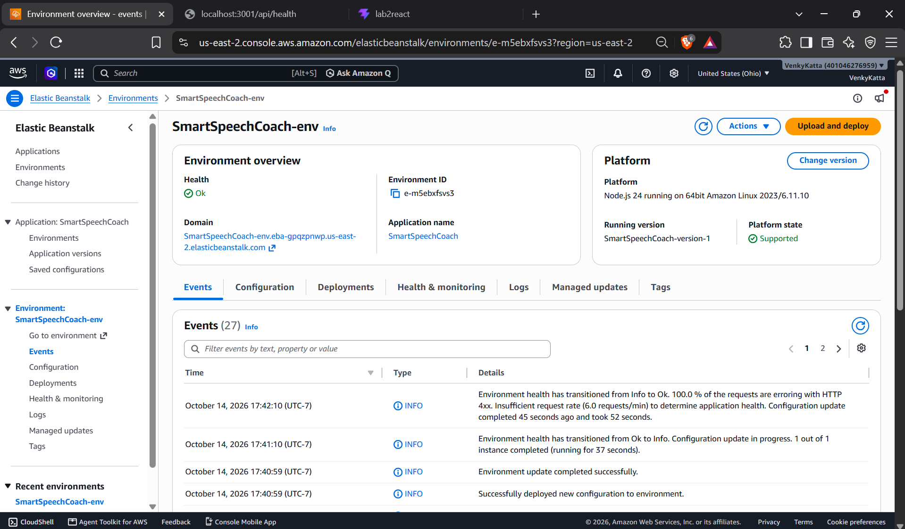

### Backend Health Check

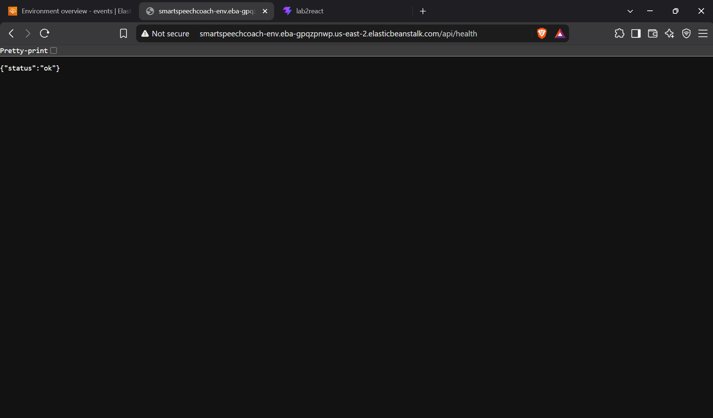

### Final Full-Stack AWS Deployment

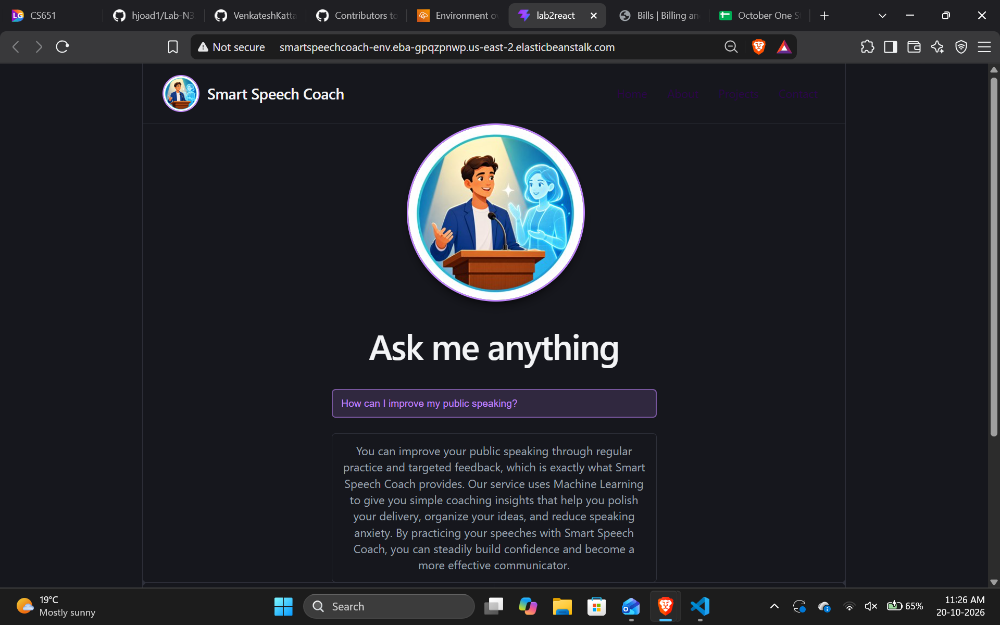

## N3.3 vs N3.4

| Lab | Frontend Deployment | Backend Deployment |
|---|---|---|
| N3.3 | Firebase Hosting | Google Cloud Run |
| N3.4 | AWS Elastic Beanstalk | AWS Elastic Beanstalk |

In Lab N3.3, the React frontend and Express backend were deployed as separate cloud services. In Lab N3.4, the production React build is served by the Express backend, allowing the entire application to run in one Elastic Beanstalk environment.

## AWS Elastic Beanstalk vs Google Cloud Run

| Feature | AWS Elastic Beanstalk | Google Cloud Run |
|---|---|---|
| Deployment | Application ZIP | Source/container-based deployment |
| Setup | More configuration required | Simpler deployment workflow |
| Scaling | Managed through environment configuration | Automatically managed |
| Infrastructure control | More control over application environment | Less infrastructure management |
| Frontend hosting | Can host frontend and backend together | Commonly used for backend/services |
| Server configuration | Supports custom Nginx/application configuration | More abstracted platform configuration |

### AWS Elastic Beanstalk Advantages

- Can host the React frontend and Express backend in one environment.
- Provides more control over the application runtime and proxy configuration.
- Environment variables are easy to configure in the AWS console.
- Works well for traditional Node.js web applications.

### AWS Elastic Beanstalk Disadvantages

- Requires more configuration than Cloud Run.
- Deployment ZIP files must be prepared correctly.
- Proxy/server settings may need custom configuration.
- The Elastic Beanstalk environment must be managed while it is running.

### Google Cloud Run Advantages

- Faster and simpler service deployment.
- Automatically scales based on traffic.
- Requires less infrastructure management.
- Well suited for stateless APIs and backend services.

### Google Cloud Run Disadvantages

- Provides less control over the underlying environment.
- Frontend hosting is typically handled separately.
- Custom server configuration is less direct than with Elastic Beanstalk.

## Final Result

Lab N3.4 successfully deployed the complete Smart Speech Coach application to AWS Elastic Beanstalk.

The final request flow is:

```text
Browser
→ AWS Elastic Beanstalk
→ React Frontend
→ /api/askanything
→ Express Backend
→ Gemini API
→ JSON Response
→ React UI
```

This demonstrates a working full-stack AI web application in which the frontend, backend, and Gemini integration operate through a single AWS Elastic Beanstalk deployment.
