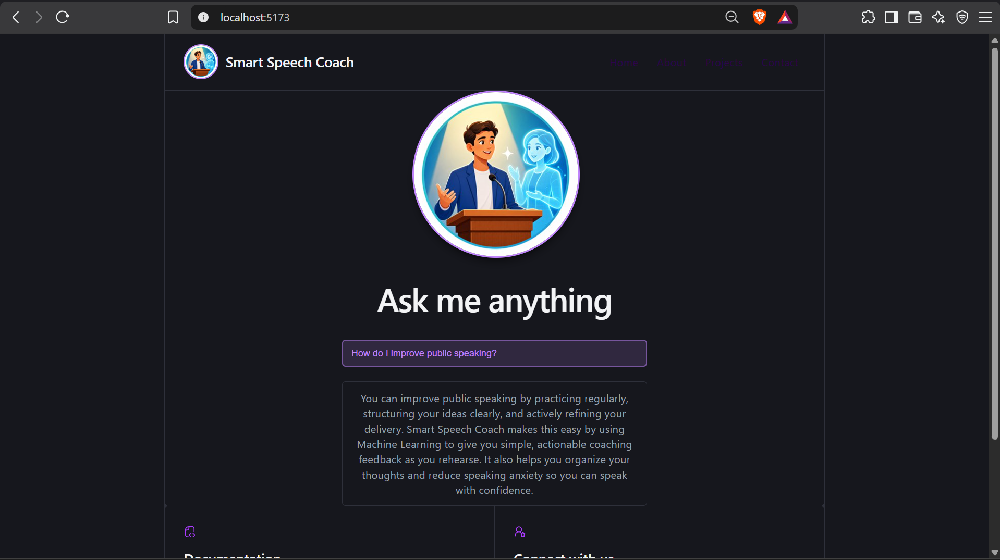

# Smart Speech Coach

Smart Speech Coach is an AI-enabled full-stack web application. The React/Vite
frontend sends questions to a Node.js/Express backend using `fetch`. The
backend calls Gemini and returns the answer to the frontend.

## Deployed Application

- Frontend: <https://gen-lang-client-0800605818.web.app>
- Backend: <https://smart-speech-coach-backend-389363739519.us-central1.run.app>
- Health check: <https://smart-speech-coach-backend-389363739519.us-central1.run.app/api/health>
- Google Cloud and Firebase project ID: `gen-lang-client-0800605818`

These URLs were generated at the time of deployment and are included as
deployment evidence. They may no longer be active or reachable. When
reproducing the deployment, use the URLs printed by the current Cloud Run and
Firebase Hosting commands instead.

The frontend is hosted by Firebase Hosting. The backend runs on Cloud Run in
the `us-central1` region.


## Environment Setup

Create these local files from the example files. They are ignored by Git:

```text
frontend/.env
backend/.env
backend/.env.cloudrun
```

The local backend file uses dotenv format:

```env
GEMINI_API_KEY=YOUR_GEMINI_API_KEY
port=3001
allowedOrigins=http://localhost:5173,http://127.0.0.1:5173,https://gen-lang-client-0800605818.web.app
geminiAskAnythingModel=gemini-3.8-flash
askAnythingPrompt="You are going to answer questions about Smart Speech Coach. Keep responses concise."
```

The Cloud Run file uses YAML format and does not define `PORT`, because Cloud
Run provides that variable:

```yaml
GEMINI_API_KEY: "YOUR_GEMINI_API_KEY"
geminiAskAnythingModel: "gemini-3.8-flash"
askAnythingPrompt: "You are going to answer questions about Smart Speech Coach. Keep responses concise."
allowedOrigins: "http://localhost:5173,http://127.0.0.1:5173,https://gen-lang-client-0800605818.web.app"
```

The example file is currently named `backend/.env.coudrun.example` (with a
typo). Copy it to `backend/.env.cloudrun` and use the YAML format above.

Set `frontend/.env` to use the deployed backend:

```env
VITE_SERVER_REMOTE=Y
VITE_SERVER_URL_REMOTE=https://smart-speech-coach-backend-389363739519.us-central1.run.app
VITE_SERVER_URL_LOCAL=http://localhost:3001
```

Never commit environment files because they contain the Gemini API key.

## Local Development

```bash
cd backend && npm install
cd ../frontend && npm install
npm run lint
npm run build
```

Start the backend with `npm run dev` from `backend`, then start the frontend
with `npm run dev` from `frontend`. The local frontend runs at
`http://localhost:5173` and calls `http://localhost:3001` when
`VITE_SERVER_REMOTE=N`.

Test the local backend:

```bash
curl http://localhost:3001/api/health
```


# Lab N3.3 — Google Cloud Run

```bash
gcloud auth login
gcloud auth list
gcloud config set project gen-lang-client-0800605818
```


Deploy from `backend`:

```bash
cd backend
gcloud run deploy smart-speech-coach-backend --source . --project gen-lang-client-0800605818 --region us-central1 --allow-unauthenticated --env-vars-file .env.cloudrun
```

`--source .` builds the Node.js service with Google Cloud Buildpacks.
`--allow-unauthenticated` permits the public Firebase frontend to call it.


Test the deployed backend:

```bash
export CLOUD_RUN_URL="https://smart-speech-coach-backend-389363739519.us-central1.run.app"
curl "$CLOUD_RUN_URL/api/health"
curl -X POST "$CLOUD_RUN_URL/api/askanything" -H "Content-Type: application/json" -d '{"message":"Give me one public speaking tip."}'
```


## Firebase Hosting Deployment

Firebase was enabled on the existing Gemini project. The project ID
`gen-lang-client-0800605818` is used by both Google Cloud and Firebase; it is a
project identifier, not a Firebase account.

```bash
npx -y firebase-tools@latest login
npx -y firebase-tools@latest use
npx -y firebase-tools@latest projects:list
```


Build the frontend after setting `VITE_SERVER_URL_REMOTE`:

```bash
cd frontend
npm run build
```


Deploy the `frontend/dist` directory configured in `firebase.json`:

```bash
cd ..
npx -y firebase-tools@latest deploy --only hosting
```


## Production Verification

```bash
curl https://smart-speech-coach-backend-389363739519.us-central1.run.app/api/health
```


Open <https://gen-lang-client-0800605818.web.app>, submit a question, and
confirm that the answer is displayed. The browser sends `POST /api/askanything`
to Cloud Run and renders the returned `answer`.


---

# Lab N3.4 — AWS Elastic Beanstalk

Lab N3.4 uses the same Smart Speech Coach application developed for Lab N3.3, but deploys the existing Node.js/Express backend to **AWS Elastic Beanstalk** instead of Google Cloud Run.

The React frontend continues to communicate with the backend using the same `fetch()` request and REST API endpoints.

## N3.4 Architecture

```text
React + Vite Frontend
        |
        | fetch()
        v
AWS Elastic Beanstalk
        |
        v
Node.js + Express Backend
        |
        v
Google Gemini API
        |
        v
JSON Response
        |
        v
React UI
```

No application logic was rewritten for AWS. The same backend code from Lab N3.3 was reused.

## AWS Elastic Beanstalk Deployment

The backend was deployed as a Node.js web-server environment using AWS Elastic Beanstalk.


Deployed backend:

```text
http://smartspeechcoach-env.eba-gpqzpnwp.us-east-2.elasticbeanstalk.com
```

Health endpoint:

```text
http://smartspeechcoach-env.eba-gpqzpnwp.us-east-2.elasticbeanstalk.com/api/health
```

Expected response:

```json
{
  "status": "ok"
}
```


## Backend Deployment Package

Only the backend files required by Elastic Beanstalk were included in the deployment ZIP:

```text
server.js
package.json
package-lock.json
```

The files were placed directly at the root of the ZIP archive.

The following were not included:

```text
node_modules/
.env
frontend/
```

Sensitive values such as the Gemini API key were not uploaded in the ZIP or committed to GitHub.

## Elastic Beanstalk Environment Configuration

The backend environment variables were configured through:

```text
AWS Elastic Beanstalk
-> Environment
-> Configuration
-> Software
-> Environment properties
```

The following properties were configured:

```text
GEMINI_API_KEY
geminiAskAnythingModel
allowedOrigins
askAnythingPrompt
```

The Gemini API key is stored only as an Elastic Beanstalk environment property and is not stored in this repository.

The existing backend already supports a cloud-provided port:

```javascript
const port = process.env.PORT || 3001;
```

This allows the same code to work locally and in Elastic Beanstalk.

## Connect the React Frontend to AWS

For Lab N3.4, the local React frontend was configured to send requests to the Elastic Beanstalk backend.

The local `frontend/.env` configuration was:

```env
VITE_SERVER_REMOTE=Y
VITE_SERVER_URL_REMOTE=http://smartspeechcoach-env.eba-gpqzpnwp.us-east-2.elasticbeanstalk.com
VITE_SERVER_URL_LOCAL=http://localhost:3001
```

The real `.env` file is excluded from GitHub.

After restarting the Vite development server:

```bash
npm run dev
```

the frontend runs at:

```text
http://localhost:5173
```

and sends requests to the AWS-hosted backend.

## N3.4 Verification

The AWS backend was verified using:

```text
GET /api/health
```

and:

```text
POST /api/askanything
```

The `/api/askanything` endpoint successfully returned a Gemini-generated response.



The complete request flow for Lab N3.4 is:

```text
React Frontend
-> fetch()
-> AWS Elastic Beanstalk
-> Express Backend
-> Gemini API
-> JSON Response
-> React UI
```

## N3.3 vs N3.4

| Lab | Backend Deployment | Frontend |
|---|---|---|
| N3.3 | Google Cloud Run | Firebase Hosting / React |
| N3.4 | AWS Elastic Beanstalk | Local React frontend |

The purpose of Lab N3.4 is to demonstrate that the same Node.js/Express application can be deployed to a different cloud platform without rewriting the application logic.